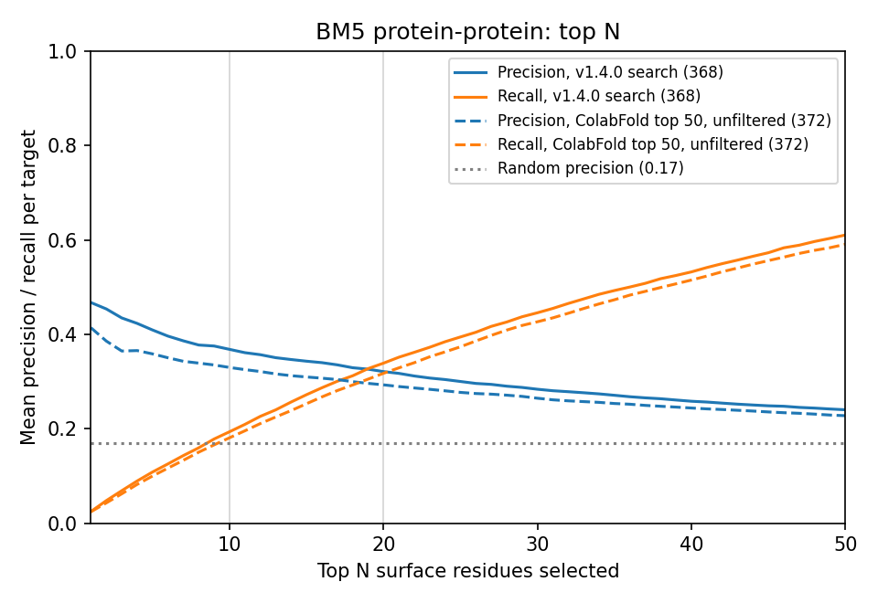
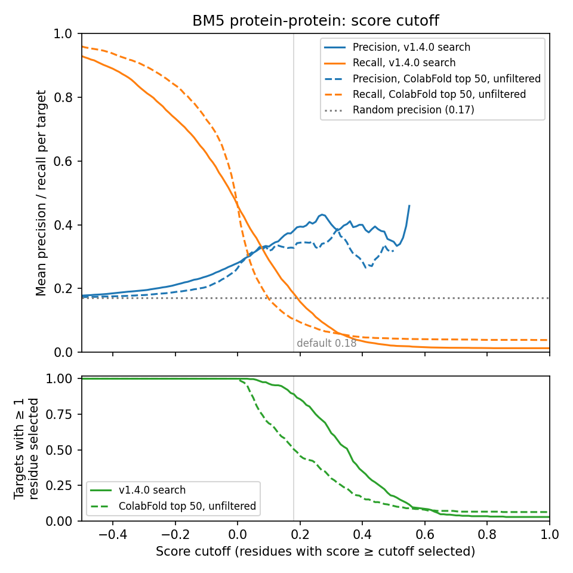
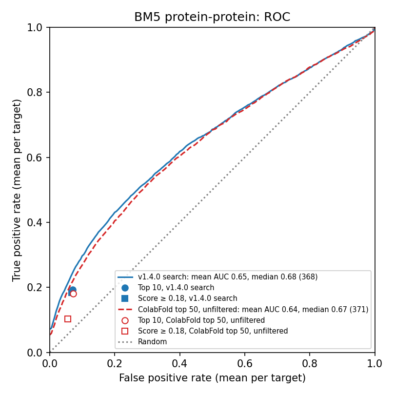
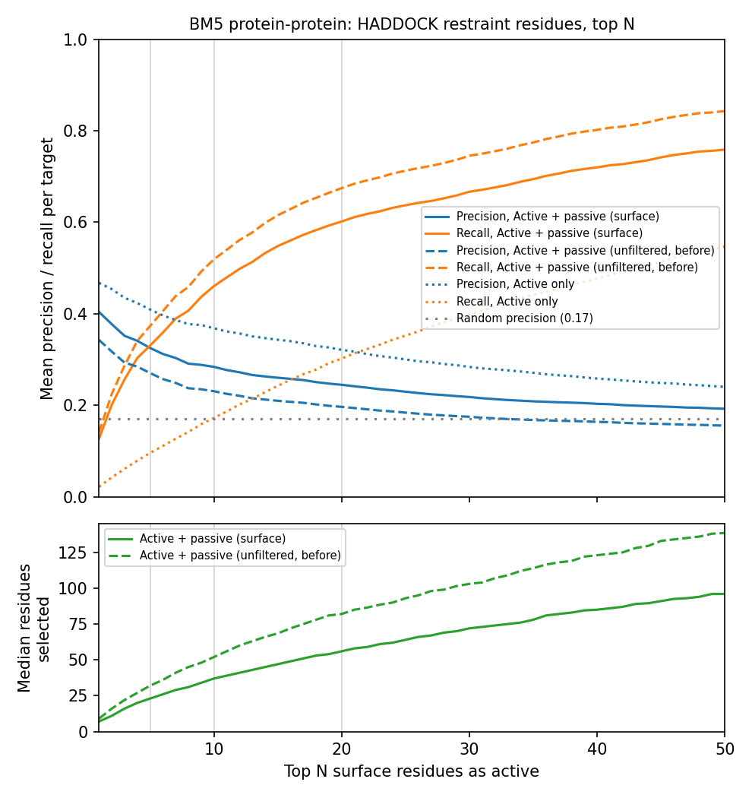
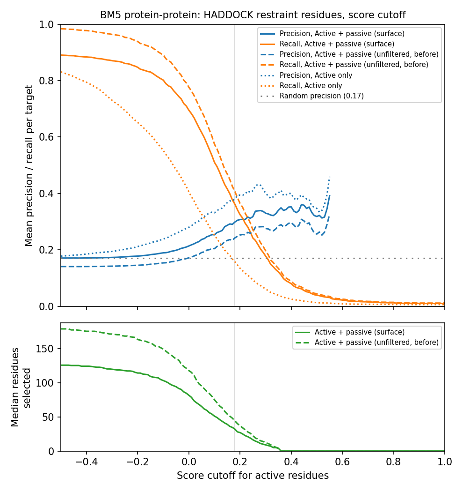

# Benchmark: protein-protein interfaces

How well WHISCY predicts protein-protein interfaces, on the complexes of
Docking Benchmark 5 without antibodies, with the homolog search of WHISCY
1.4.0 (ColabFold MMseqs2). Run in October 2026. The docking benchmark with
HADDOCK, using these predictions as restraints, is in progress.

## Dataset

- **Complexes:** the 187 complexes of Docking Benchmark 5 (Vreven et al.,
  J. Mol. Biol. 2015, doi:10.1016/j.jmb.2015.07.016) that contain no
  antibody, antibody fragment or nanobody, from the HADDOCK-ready version
  [haddocking/BM5-clean](https://github.com/haddocking/BM5-clean).
- **Structures:** both partners of each complex, from the bound structures:
  374 chains of 28 to 2119 residues (median 182.5). 52 partners made of
  several chains are merged into one chain in BM5-clean; the main results
  are for the 322 single-chain partners, as users submit them.
- **Categories:** enzyme-inhibitor (EI, 44 complexes), enzyme-substrate (ES,
  17), enzyme with a regulatory or accessory chain (ER, 26), G-protein (OG,
  23), receptor (OR, 22) and other (OX, 50).
- **True interface:** the residues with a heavy atom within 5 Å of a heavy
  atom of the partner. Only surface residues count, since only those are
  scored. The median interface has 19 surface residues; on average 13% of
  the surface residues are interface residues.

## Protocol

- `whiscy_setup` on each chain, without an alignment: WHISCY searches for
  homologs (ColabFold MMseqs2, at most 90% identity, at least 50% coverage,
  up to 250 homologs; EBI BLAST below 10).
- The default protocol of the web server: `whiscy` on the surface and on the
  low-accessible residues, interface propensities (`whiscy_consadjust`) and
  surface smoothing (`whiscy_parasmooth`).
- **Precision:** the share of selected residues that are interface residues.
  **Recall:** the share of interface residues that are selected. Values are
  pooled over all chains, or averaged per chain (mean).

368 of the 374 chains got an alignment. The 6 without one are merged
partners of 456 to 2119 residues, for which almost no homolog covers half of
the merged sequence.

## Interface prediction

Single-chain partners (322 chains), precision (P) and recall (R), pooled or
mean per chain, and the chains with at least one residue selected:

| Selection | P pooled | R pooled | P mean | R mean | Chains |
| --- | --- | --- | --- | --- | --- |
| Top 10 | 0.39 | 0.20 | 0.39 | 0.21 | 322 / 322 |
| Top 20 | 0.34 | 0.34 | 0.34 | 0.36 | 322 / 322 |
| Top 20% | 0.27 | 0.37 | 0.32 | 0.36 | 322 / 322 |
| Score ≥ 0.18 | 0.35 | 0.17 | 0.41 | 0.17 | 282 / 322 |

A random pick has a precision of 0.14. For the merged multi-chain partners
the top-10 precision is 0.22 (random 0.09).

By category (all chains, pooled precision / recall):

| Category | Chains | Top 10 | Top 20 | Score ≥ 0.18 |
| --- | --- | --- | --- | --- |
| EI enzyme-inhibitor | 90 | 0.44 / 0.22 | 0.37 / 0.38 | 0.40 / 0.14 |
| ES enzyme-substrate | 34 | 0.39 / 0.23 | 0.33 / 0.39 | 0.19 / 0.28 |
| ER enzyme-regulatory | 51 | 0.40 / 0.18 | 0.35 / 0.31 | 0.37 / 0.21 |
| OG G-protein | 46 | 0.53 / 0.25 | 0.45 / 0.43 | 0.41 / 0.33 |
| OR receptor | 45 | 0.21 / 0.10 | 0.22 / 0.21 | 0.12 / 0.09 |
| OX other | 102 | 0.28 / 0.15 | 0.25 / 0.26 | 0.22 / 0.14 |

### Top N and score cutoff

Mean precision and recall per chain (all 368 chains) for the top 1 to 50
residues and for score cutoffs from −0.5 to 1.0. The random precision per
chain is 0.17.

| Top N | 1 | 2 | 5 | 10 | 20 | 30 | 50 |
| --- | --- | --- | --- | --- | --- | --- | --- |
| Precision | 0.47 | 0.45 | 0.41 | 0.37 | 0.32 | 0.28 | 0.24 |
| Recall | 0.02 | 0.05 | 0.11 | 0.19 | 0.34 | 0.45 | 0.61 |

| Score cutoff | −0.2 | 0.0 | 0.1 | 0.18 | 0.3 | 0.4 |
| --- | --- | --- | --- | --- | --- | --- |
| Precision | 0.21 | 0.28 | 0.33 | 0.38 | 0.40 | 0.40 |
| Recall | 0.73 | 0.46 | 0.29 | 0.18 | 0.08 | 0.04 |
| Chains with ≥ 1 selected | 100% | 100% | 96% | 89% | 62% | 35% |

### ROC

Mean ROC curve per chain, over all surface residues ranked by score. The
markers are the top 10 and the 0.18 cutoff.

Mean AUC: 0.65 over all chains (median 0.68), 0.66 for the single-chain
partners. By category: EI 0.66, ES 0.70, ER 0.68, OG 0.76, OR 0.54, OX 0.60.

## HADDOCK restraints

`whiscy_haddock` turns the prediction into active residues and passive
residues: the surface residues with an atom within 6.5 Å of the Cα of an
active residue. Here the active residues are the top N residues or those
above a score cutoff. Precision and recall of the combined list are means
per chain against the full interface, buried residues included, so recall
cannot exceed 0.88 with surface passive residues. The lower panels show the
median number of residues in the list.

| Active residues | Median list size | Precision | Recall | Chains |
| --- | --- | --- | --- | --- |
| Top 1 | 7 | 0.40 | 0.13 | 368 / 368 |
| Top 5 | 23 | 0.33 | 0.33 | 368 / 368 |
| Top 10 | 37 | 0.28 | 0.46 | 368 / 368 |
| Top 20 | 56 | 0.24 | 0.60 | 368 / 368 |
| Score ≥ 0.1 | 51 | 0.25 | 0.51 | 355 / 368 |
| Score ≥ 0.18 | 32 | 0.30 | 0.36 | 328 / 368 |
| Score ≥ 0.3 | 9 | 0.33 | 0.18 | 227 / 368 |

## Findings

- **Ranking works:** for single-chain partners, the top 10 residues have a
  precision of 0.39, against 0.14 for a random pick. The best-scored 1 to 5
  residues are the most precise (0.41–0.47).
- **Results depend on the type of complex:** G-proteins and
  enzyme-inhibitor complexes score best (top-10 precision 0.53 and 0.44),
  receptors and other complexes worst (0.21 and 0.28). For receptors the
  0.18 cutoff is no better than random.
- **Top 10 or score cutoff:** per chain, the 0.18 cutoff (precision 0.38,
  recall 0.18) performs like the top 10 (0.37 and 0.19), but 11% of the
  chains get no active residue at 0.18, and the number of active residues
  varies from 0 to 55 per chain (median 7). As HADDOCK restraints, the top
  10 gives a list of 37 residues (precision 0.28, recall 0.46) and
  restraints for every chain; the 0.18 cutoff gives 32 residues (0.30 and
  0.36). WHISCY therefore gives both selections.
- **Submit single chains:** merged multi-chain partners are poorly predicted
  (top-10 precision 0.22), since each homolog covers only part of the merged
  sequence.
- **Check the scores:** with gappy alignments a few chains (8 of 368) get
  scores on a wrong scale (above 5, instead of about −1 to 1); their
  predictions are not reliable.
